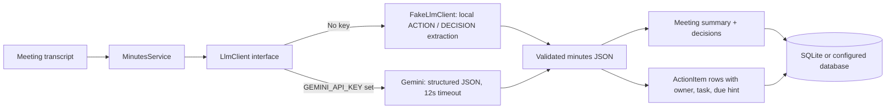

# Meeting Notes AI

Meeting Notes AI is a small, recruiter-ready meeting desk: paste a transcript and get a concise summary, explicit decisions, and owner-assigned action items saved to a meeting history. The app runs locally without an AI key; Gemini is an optional provider behind a swappable interface.

## AI design



`MinutesService` owns the generation boundary: it calls `App\Services\Llm\LlmClient`, validates the JSON contract, then persists the meeting and action rows together in a database transaction. Malformed output becomes a friendly 422 response; provider failures become a friendly 503 response without saving a partial meeting. Tests bind `FakeLlmClient` so AI behavior is deterministic and independent of network access.

## Run locally (no API key required)

Requirements: PHP 8.3+, Composer, Node.js 20+, and npm.

```bash
composer install
cp .env.example .env
php artisan key:generate
php artisan migrate --seed
npm install
npm run dev
```

Open the Vite/Laravel URL shown in the terminal (usually `http://localhost:8000`). The default configuration uses SQLite, local file cache, and the synchronous queue; no Redis, account, external meeting integration, or API key is needed.

With `GEMINI_API_KEY` unset, `FakeLlmClient` extracts lines prefixed `ACTION:` and `DECISION:` from the transcript. Write action lines as `ACTION: Owner | Task | Due hint` (the due hint is optional), for example:

```text
DECISION: Keep the release focused on onboarding improvements.
ACTION: Riley | Update the invite flow copy | Thursday
```

The example button loads a 20-line fictional Harbor Desk standup transcript with decisions and five owned action items, ready to generate in offline mode.

### Optional Gemini provider

Set `GEMINI_API_KEY` in your local `.env` and optionally change `GEMINI_MODEL` (defaults to `gemini-2.5-flash`). Restart the app after changing configuration. The Gemini HTTP request has a 12-second timeout and requests JSON-only output. The API key stays server-side and must never be committed.

## Demo data

Run `php artisan migrate --seed` to create two fictional Harbor Desk examples: **Sprint review** and **Incident retro**, each with example decisions and action items. No real client names or sensitive meeting data are included. There are no demo login credentials because this focused v1 does not require authentication.

## Tests

```bash
php artisan test
```

The Pest feature tests prove that:

- The default `LlmClient` binding is `FakeLlmClient` and a transcript with `ACTION:` lines generates and persists at least two action items with owners.
- Meeting, decisions, and action rows are returned together by the POST endpoint.
- An empty transcript receives HTTP 422, and malformed LLM JSON is handled gracefully without persisting a meeting.
- Provider exceptions receive a friendly HTTP 503 instead of an unhandled 500.
- The meeting desk loads persisted history and its action items.

To run the full static and frontend checks used by the starter kit:

```bash
composer test
npm run check
npm run types:check
npm run build
```

## Stack

- Laravel 13 / PHP 8.3+
- Vue 3, TypeScript, Inertia, and Tailwind CSS
- SQLite by default; Eloquent models for meetings and action items
- `LlmClient` interface with deterministic local extraction and optional Gemini

## Scope

This v1 accepts pasted text only. It does not connect to Zoom or Meet, process recording uploads, use Redis, or claim to be a source of truth. Review generated notes before sharing or acting on them.
